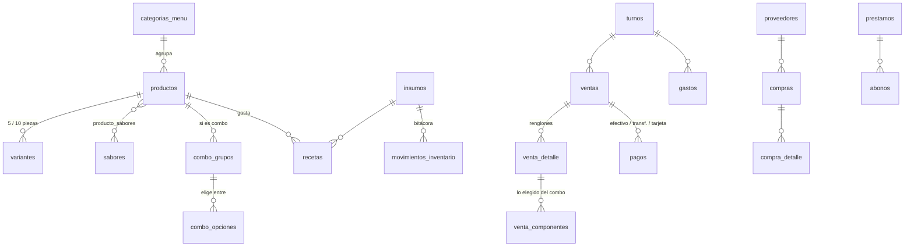

# Base de datos Monchosos (Supabase)

La base de datos vive en **Supabase** (PostgreSQL 17 en la nube). La app se conecta directo, con la llave pública (*publishable*). Por eso **toda la seguridad está en la base de datos**, con Row Level Security (RLS).

## Estructura

| Archivo | Qué hace |
|---|---|
| `migrations/…01_esquema.sql` | Tablas, triggers y vistas |
| `migrations/…02_seguridad.sql` | RLS en todas las tablas, acceso solo para `usuarios_permitidos`, funciones internas en el esquema `interno` |
| `migrations/…03_menu.sql` | Menú real: 35 productos, variantes, sabores y combos, más el producto "Extra" de precio libre |
| `migrations/…04_catalogos.sql` | Proveedores, insumos, préstamos y activos (reales) y **recetas de ejemplo** |
| `tests/pruebas.sql` | Pruebas automáticas, incluida la seguridad |
| `config.toml` | Configuración de la CLI y del entorno local |

**Regla:** nunca edites una migración que ya se subió. Para cambiar algo, crea una nueva:
`npx supabase@2.118.0 migration new descripcion_del_cambio`.

## Quién puede entrar

- **Sin sesión (anon):** no ve nada.
- **Con sesión de Google:** solo si su correo está en la tabla **`usuarios_permitidos`**. No hay roles: los que están en la lista pueden hacer todo.
- Para dar acceso, en el panel de Supabase ve a **Table Editor → usuarios_permitidos → Insert row**, o usa el SQL Editor:
  ```sql
  insert into usuarios_permitidos (correo, nombre) values ('correo@gmail.com', 'Nombre');
  ```
  Los correos **no** van en las migraciones, porque el repositorio es público.

## Uso diario (CLI)

Requiere Node y Docker Desktop abierto.

```bash
npx supabase@2.118.0 db start          # Postgres local con todas las migraciones
docker exec -i supabase_db_Gestor_Hamburgueseria psql -U postgres -v ON_ERROR_STOP=1 -f - < supabase/tests/pruebas.sql
npx supabase@2.118.0 db lint --local   # linter de Supabase
npx supabase@2.118.0 db stop           # apagar
npx supabase@2.118.0 db reset          # borrar lo local y volver a aplicar todo
```

Para subir a la nube (la primera vez hay que hacer `login` y `link`):

```bash
npx supabase@2.118.0 login
npx supabase@2.118.0 link --project-ref ldkqaauywvlunuxavdzk   # pide la contraseña de la BD
npx supabase@2.118.0 db push                                   # aplica las migraciones pendientes
```

CI (job "Base de datos") levanta Supabase en GitHub Actions, aplica las migraciones, pasa el linter y ejecuta las pruebas en cada PR.

## Modelo de datos



### Reglas que aplica la base de datos (triggers)

- **Precio congelado:** si un renglón de venta llega sin `precio_unitario`, se toma el precio actual. Si después cambia el menú, las ventas viejas no se alteran. Cada cambio de precio queda en `historial_precios`.
- **Validaciones:**
  - Alitas y boneless exigen variante, y el sabor tiene que corresponder al producto.
  - Solo puede haber un turno abierto.
  - El producto "Extra" exige precio a mano y una nota.
  - Un descuento exige motivo.
- **Inventario automático:** las compras suman existencias y actualizan el costo unitario. Las ventas restan según las `recetas`, incluyendo lo elegido en los combos. Cancelar o borrar una venta devuelve los insumos. Para ajustes manuales, inserta un movimiento de tipo `ajuste` o `merma` en `movimientos_inventario`.
- **Autoría:** `registrado_por`, `abierto_por` y similares se llenan solos con el usuario de la sesión (`auth.uid()`).

### Vistas (reportes, respetan RLS)

| Vista | Para qué |
|---|---|
| `v_menu` | Menú plano con precio final |
| `v_ventas` | Cada venta con `subtotal`, `descuento`, `total`, `pagado` y `pendiente` |
| `v_corte_turno` | Corte de caja (un turno puede durar varios días): pedidos, ventas, descuentos, cobrado por método, "Mercado" (transferencia + tarjeta), gastos, compras, pagos de deuda, balance, efectivo esperado y diferencia |
| `v_ventas_por_categoria` | Unidades y total por día y categoría |
| `v_insumos_por_agotarse` | Insumos en o por debajo del stock mínimo |
| `v_prestamos` | Monto, abonado y saldo de cada préstamo |

### Pendientes conocidos

- Las **recetas** son cantidades de ejemplo: hay que ajustarlas con la pareja.
- Las **imágenes** del menú (`productos.imagen_url`) se agregan después; irán en Supabase Storage.
- Por confirmar con la pareja (vienen de `Comandas.xlsx`): qué es "El rollo" en los gastos y si gastos como galletas, Danone o cenas son del negocio o personales.
